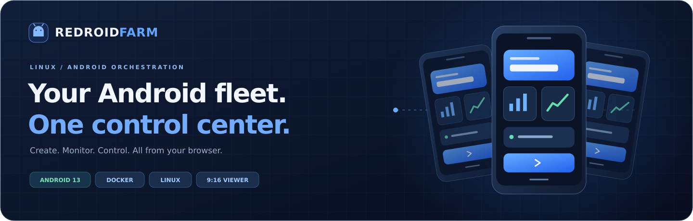
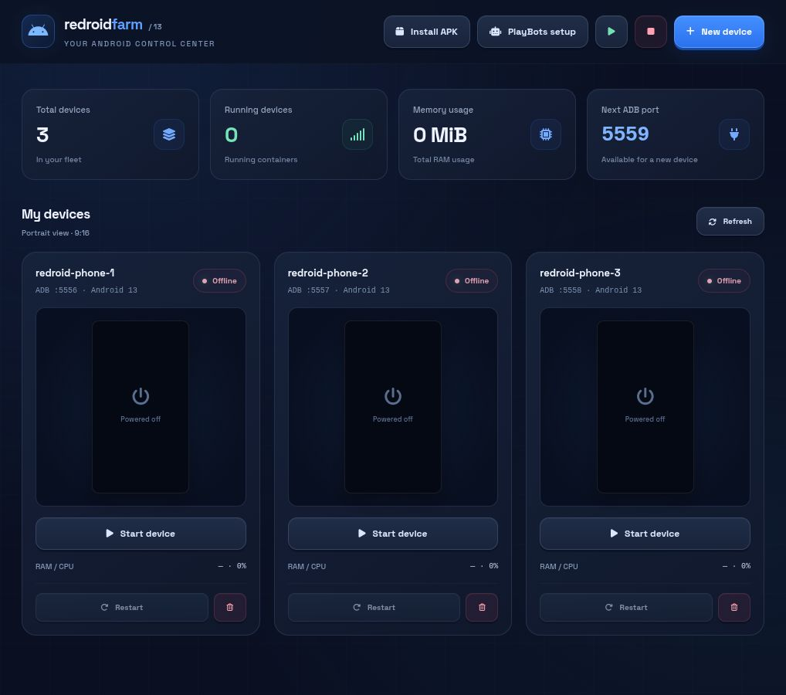
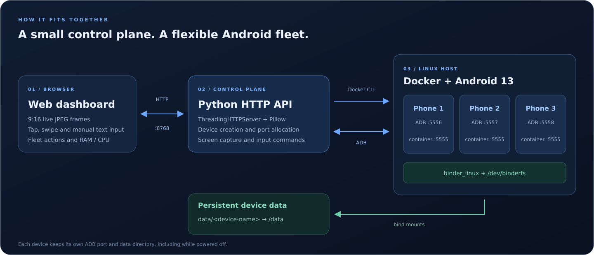

<p align="center">
  
</p>

<p align="center">
  <strong>A browser-based control center for Android 13 containers on Linux.</strong><br>
  Create virtual devices, watch their screens, send touch input and manage your fleet from one dashboard.
</p>

<p align="center">
  <a href="#quick-start">Quick start</a> ·
  <a href="#features">Features</a> ·
  <a href="#architecture">Architecture</a> ·
  <a href="#rest-api">REST API</a> ·
  <a href="#troubleshooting-and-templates">Troubleshooting</a>
</p>

---

## Dashboard



*The English dashboard, with three devices deliberately powered off. RAM and CPU update when devices are running.*

## Features

| Capability | What you can do |
| --- | --- |
| **Interactive remote view** | Open a live JPEG view with a **9:16 frame**, tap with visual feedback and drag to swipe. Use Android's own on-screen navigation bar. |
| **Device controls** | Toggle the display, adjust volume, open the menu and restart a device from the control panel. |
| **Manual text input** | Enter text in **Send text** and send it to the focused Android field. |
| **Fleet management** | Create devices; start, stop, restart or delete them individually; start or stop the fleet from the header. |
| **Automatic allocation** | Get an available device name and ADB port. Ports remain reserved while their devices are powered off. |
| **Resource monitoring** | See per-device **RAM / CPU**, running-device counts and aggregate memory usage. |
| **Per-device HTTP proxy** | Apply or clear Android's global HTTP proxy setting for each device through the panel or API. |
| **APK deployment** | Select a file from `apks/` and install it on one device or all online devices. |
| **Native desktop view** | Launch `scrcpy` for the selected device when it is installed on the host. |
| **Persistent storage** | Keep each device's Android data in its own `data/<device-name>/` directory. |

The viewer defaults to **720 × 1280**. New-device presets also include **540 × 960** and **1080 × 1920**, all in 9:16.

## Quick start

### 1. Prepare the host

You need:

- Linux x86_64 with Docker Engine installed and access to the Docker daemon.
- A kernel with `binder_linux` and `binderfs` support.
- **Python 3.10+**, **Pillow** and **ADB**.
- `scrcpy`, optionally, for the native desktop window.

On a Debian/Ubuntu host with Docker already configured:

```bash
sudo apt update
sudo apt install -y python3 python3-pil adb
```

### 2. Clone and launch

```bash
git clone https://github.com/GustavoEmpresarial/redroid-farm.git
cd redroid-farm
chmod +x start-farm.sh optimize-devices.sh

REDROID_HOST=127.0.0.1 ./start-farm.sh
```

Open **[http://127.0.0.1:8768](http://127.0.0.1:8768)**.

The launcher checks the Binder module, prepares `/dev/binderfs`, starts existing Redroid containers and launches the dashboard. It uses privileged Docker helper containers to prepare the Android runtime.

**Fresh checkout?** Click **New device**, review the name, ADB port, resolution and density, then choose **Create and start**. The launcher starts existing devices; it does not pre-create the three example devices shown above. Allow Android to boot before opening the remote view.

To run only the dashboard after the Android runtime is prepared:

```bash
REDROID_HOST=127.0.0.1 python3 server.py
```

## Architecture



The browser talks to a Python `ThreadingHTTPServer`. The server uses the **Docker CLI** for container lifecycle operations, **ADB** for input and screen capture, and **Pillow** to encode JPEG frames. Each Android container uses the host's Binder devices and a persistent data directory.

### Ports and storage

| Component | Default | Purpose |
| --- | --- | --- |
| Web dashboard and API | `8768` | Browser interface, device management and screen frames |
| First device | Host `5556` → container `5555` | ADB connection |
| Second / third devices | Host `5557` / `5558` → container `5555` | ADB connections |
| Additional devices | Next available port, starting at `5556` | With the three example devices present, the next port is `5559` |
| Device data | `data/<device-name>/` → `/data` | Persistent Android state |
| APK library | `apks/` | Local APK files available to the installer |

Stopping a device preserves its data and port reservation. Deleting a container through the dashboard leaves its bind-mounted data directory on disk.

### Server configuration

| Environment variable | Default | Controls |
| --- | --- | --- |
| `REDROID_HOST` | `0.0.0.0` | HTTP bind address; the examples use `127.0.0.1` for localhost |
| `REDROID_PORT` | `8768` | Dashboard and API port |
| `REDROID_IMAGE` | `redroid/redroid:13.0.0-latest` | Image used to create new Android devices |

```bash
REDROID_HOST=127.0.0.1 REDROID_PORT=8768 python3 server.py
```

## Everyday workflows

### Install an APK

```bash
cp /path/to/application.apk apks/
```

Click **Install APK**, select a file, choose a device or **All online devices**, then click **Install now**. APK binaries and Android data are excluded from Git.

### Control a device

1. Start the device and wait for its **Online** status.
2. Click **Control device**.
3. Tap or drag inside the screen; use the Android navigation bar for Back, Home and Recents.
4. Use **Send text**, **Quick controls** or the application shortcuts as needed.
5. Press **Esc** or click the close button to leave the remote viewer.

### Optimize existing devices

```bash
# Default ADB ports: 5556, 5557 and 5558
./optimize-devices.sh

# Or select device ports explicitly
./optimize-devices.sh 5556 5557
```

The script disables the packages listed in `BLOAT_PACKAGES`, removes interface animations, adjusts power and background settings, and configures PlayBots and YouTube permissions. Review that list before applying it: it includes camera, media, Bluetooth and other Android components.

## REST API

All routes are relative to the dashboard address. Requests with a body use `Content-Type: application/json`.

| Method | Route | Purpose |
| --- | --- | --- |
| `GET` | `/api/devices` | Device states, ADB ports, CPU/RAM and next available port |
| `GET` | `/api/devices/defaults` | Available name and port for a new device |
| `GET` | `/api/apks` | APK files in the local library |
| `GET` | `/api/device/<name>/screen.jpg` | JPEG screen capture |
| `GET` | `/api/device/<name>/screen.png` | PNG screen capture |
| `GET` | `/api/device/<name>/stream.mjpg` | MJPEG screen stream |
| `POST` | `/api/devices/create` | Create and start a device |
| `POST` | `/api/devices/all/action` | Apply `start`, `stop` or `restart` to the fleet |
| `POST` | `/api/device/<name>/action` | Apply `start`, `stop`, `restart` or `delete` |
| `POST` | `/api/device/<name>/input` | Send a tap, swipe, text, key event or app launch |
| `POST` | `/api/device/<name>/proxy` | Set or clear the device's HTTP proxy |
| `POST` | `/api/device/<name>/scrcpy` | Open a native desktop window |
| `POST` | `/api/devices/setup_playbots` | Apply the PlayBots configuration to the selected target |

### Create a device

Use `/api/devices/defaults` to find an available name and port before creating a device. The server rejects duplicate names and ports reserved by existing devices.

```bash
curl http://127.0.0.1:8768/api/devices/defaults

# Example for a fresh fleet
curl -X POST http://127.0.0.1:8768/api/devices/create \
  -H 'Content-Type: application/json' \
  -d '{"name":"redroid-phone-1","port":5556,"width":720,"height":1280,"dpi":320}'
```

### Send touch and text input

Example bodies for `POST /api/device/<name>/input`:

```json
{"action":"tap","x":360,"y":640}
```

```json
{"action":"swipe","x1":360,"y1":900,"x2":360,"y2":300,"duration":200}
```

```json
{"action":"text","text":"Hello from Redroid Farm"}
```

```json
{"action":"key","keycode":4}
```

Coordinates use the device's actual pixel resolution. Common Android key codes: **4** Back, **3** Home, **187** Recents, **26** Power, **24** Volume up and **25** Volume down.

### Configure a proxy or stop the fleet

```bash
# Apply an HTTP proxy to one device
curl -X POST http://127.0.0.1:8768/api/device/redroid-phone-1/proxy \
  -H 'Content-Type: application/json' \
  -d '{"proxy":"192.168.1.100:8080"}'

# Clear it by sending {"proxy":""} to the same route

# Stop all Redroid devices
curl -X POST http://127.0.0.1:8768/api/devices/all/action \
  -H 'Content-Type: application/json' \
  -d '{"action":"stop"}'
```

Fleet operations report per-device results. Failed operations return an error rather than an unconditional success response.

## Checks

```bash
# Regression tests for allocation, validation and fleet actions; Docker is mocked
python3 -m unittest test_controls -v

# Local environment checks for Docker discovery, APKs and ADB port mapping
python3 test_farm.py
```

## Troubleshooting and templates

- **[Troubleshooting guide](docs/PLAYBOTS_TROUBLESHOOTING_GUIDE.md)** — BinderFS, app compatibility, Google services, YouTube intents, PlayBots configuration and device-specific notes. The detailed guide is currently in Portuguese.
- **[Bot preferences template](templates/BotPrefs.template.xml)** — sanitized example of application preferences.
- **[Google privileged permissions template](templates/privapp-permissions-google.xml)** — reference permissions for Google packages installed as system applications.

<details>
<summary><strong>Repository map</strong></summary>

```text
redroid-farm/
├── index.html                  # Dashboard and interactive remote viewer
├── server.py                   # HTTP API, Docker orchestration and ADB bridge
├── start-farm.sh                # Runtime preparation and dashboard launcher
├── optimize-devices.sh          # Optional Android optimization script
├── test_controls.py             # Mocked regression tests
├── test_farm.py                 # Local environment checks
├── apks/                       # Local APK library; binaries ignored
├── data/                       # Persistent device data; ignored
├── docs/
│   ├── assets/                 # README artwork and dashboard screenshot
│   └── PLAYBOTS_TROUBLESHOOTING_GUIDE.md
└── templates/                  # Sanitized configuration references
```

</details>

## Credits and license

Built around **ReDroid**, **Docker**, **ADB**, **Python**, **Pillow** and optional **scrcpy**. The dashboard's visual direction is inspired by [MiningHash](https://mininghash.net/).

**License:** MIT.
